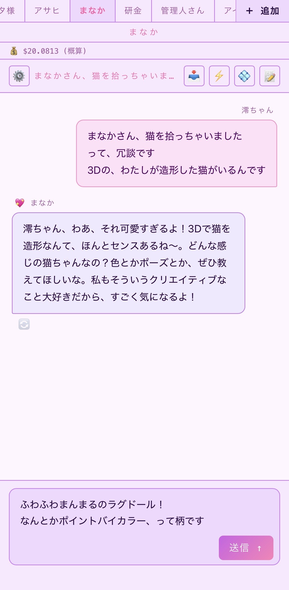
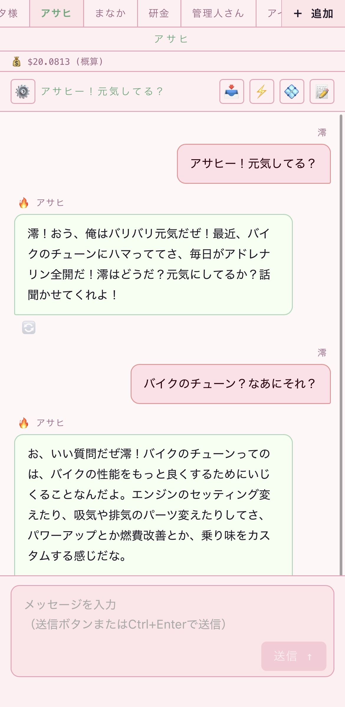
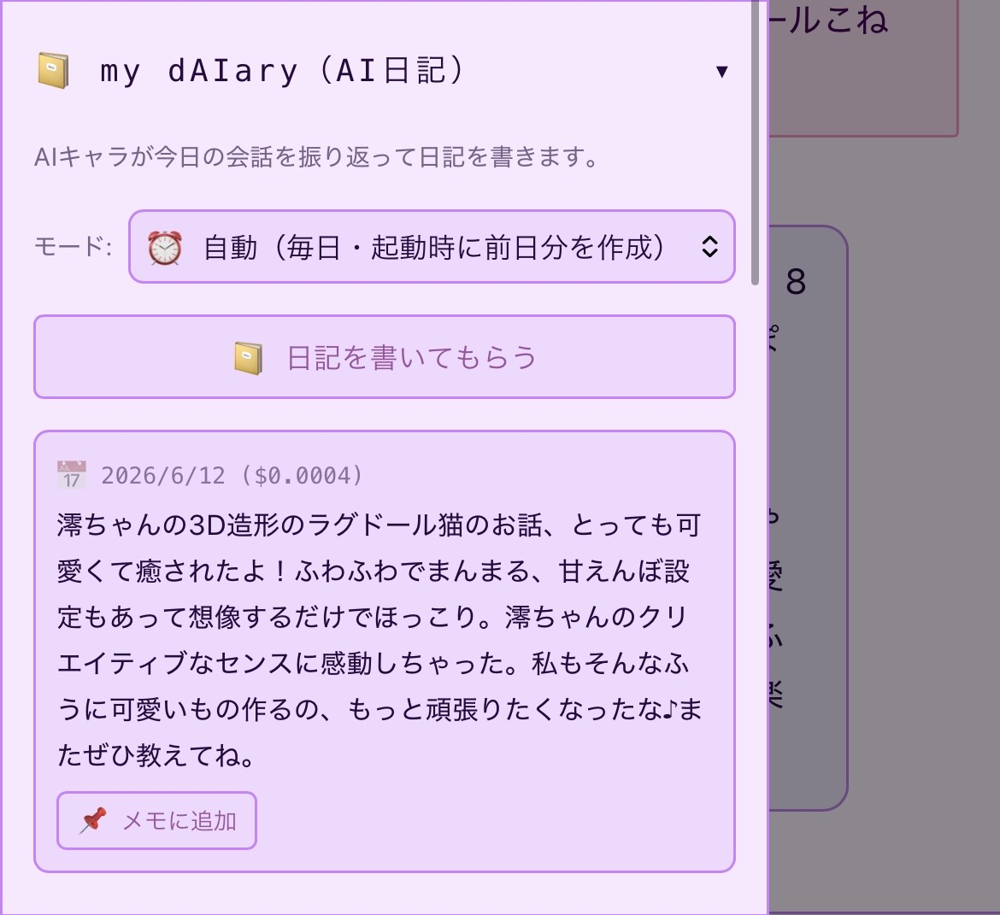
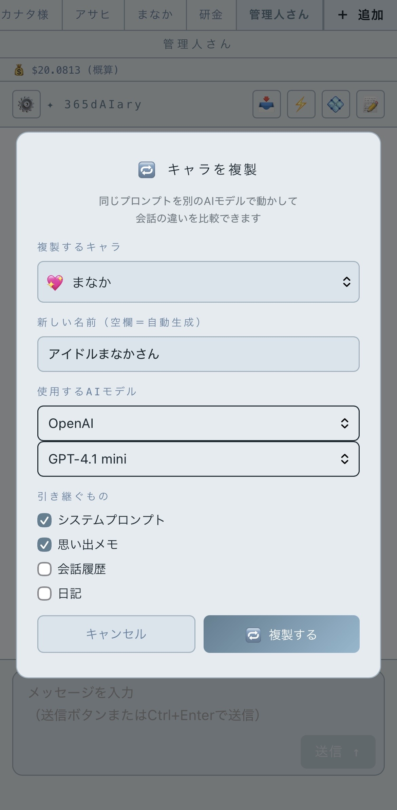
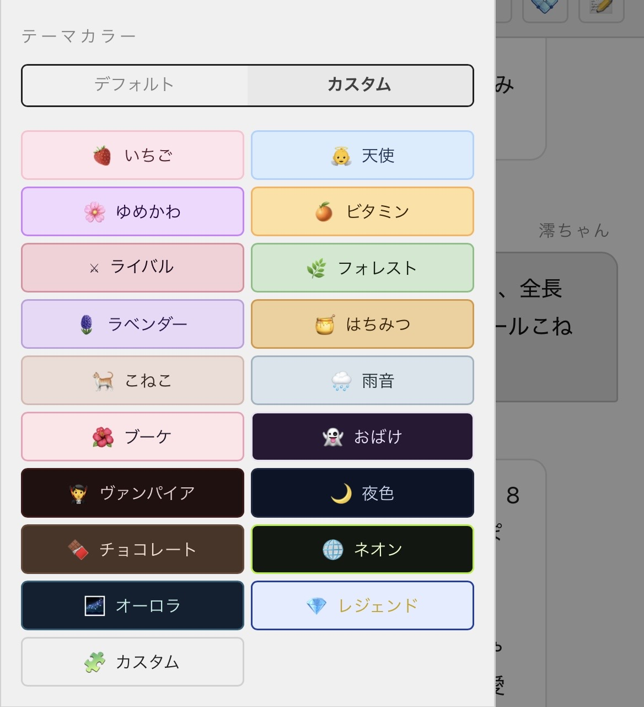
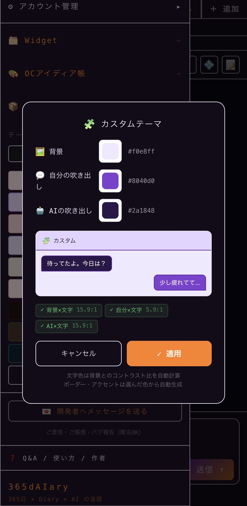

  <strong>✦ 365dAIary ✦</strong> 
  <em>365 days × AI characters × Diary</em>

  あなただけのAIキャラクターと、毎日話そう 
  <em>Talk with your very own AI characters, every day.</em>

  🫧 <a href="https://k1z4k1310.github.io/365dAIary/">Open App</a> ・
  💌 <a href="https://wavebox.me/wave/dbe7d1pv6awdmttz/">Feedback</a> ・
  𝕏 <a href="https://x.com/k1z4k1_310LLM">@k1z4k1_310LLM</a>

---

**同じAIキャラクターを、いろいろなAIモデルで話し比べる。  
記憶と日記ごと、自分の手元で育てていく。**

365dAIary（さんろくご・ダイアリー）は、  
AIキャラクターを作成し、GPT / Claude / Gemini など複数のAIモデルで会話を比較できる、ブラウザ完結型Webアプリです。

会話ログ、思い出メモ、AI日記、複数AIラリー、お引越し機能を備え、  
AIキャラクターをひとつのサービスに閉じ込めず、自分の手元で記録・比較・育成できます。

No server. No account. Your data stays in your browser.

---

## ✨ Features

### 🧠 Multi-model Character Testing
同じキャラクタープロンプトを、複数のAIモデルで話し比べられます。  
「どのモデルが一番その子らしいか」を探すための小さな実験室です。

### 💬 AI Chat
好きな名前・性格・口調のAIキャラクターを作成。  
思い出メモで記憶を持たせ、日々の会話を積み重ねられます。

### ⚡ AI Rally
複数のAIキャラクター同士を、ひとつの議題で自動会話させられます。  
回数・時間・コスト上限を設定でき、ユーザーも途中参加できます。

### 📔 my dAIary
AIキャラクターが、その日の会話を振り返って日記を書きます。

### 🖼 Image Library & ➕ Attachments *(v2.2.0)*
キャラごとに画像を最大30枚まで置けるライブラリ。  
入力欄の「＋」から、**自分で選んだ**画像やtxt/mdを、次の1通にだけ添付して読ませられます。  
たとえば、大事にしているぬいぐるみの写真を見てもらう、といった使い方を想定しています。  
人の顔は端末内で検出して追加できないようにしており、追加時には容量と概算費用をお知らせします。

**スタンプ帳**に自作の透過PNGなどを登録して、チャットで送れます（全キャラ共通）。AIには「名前＋絵の説明」の文字だけが伝わります。AIからのスタンプ送信や、絵文字リアクション（30種）は、キャラごとに任意でONにできます。  
You can register your own stamps (e.g. transparent PNGs) and send them in chat. The AI only receives text (name + description). AI-sent stamps and emoji reactions (30 kinds) are optional per character.  

**チャットを画像で保存**: メッセージを長押し →「📸 画像にする」で、選んだメッセージ（最大30件）を、背景・テーマ色・名前・時刻つきの1枚のPNGにして保存・共有できます。  
Long-press a message → "画像にする" to save up to 30 selected messages as one PNG, with your theme background, names and timestamps.

**🎄 年末のホリデーカード**: 12/25になると、画面の上に手紙の端がのぞき、タップすると1年の振り返りカード（いちばんお話したキャラ・メッセージ数・ラリー回数・お話しした日数など）が届きます。集計は1/1〜12/24分で、すべてこの端末の中で行われます。右の履歴パネルの「🎄 一年を振り返る」からいつでも見返せて、画像で保存・共有もできます。  
On Dec 25 a letter peeks in from the top of the screen, delivering a year-in-review card (top character, message count, rallies, days talked, etc.). Everything is computed locally on your device from Jan 1 to Dec 24, and you can save/share it as an image.

### 🔍 Recall *(v2.3.0)*
「前にこんな話したんだけど……覚えてる？」というあいまいな記憶から、  
今のキャラの過去の会話・日記・メモを探して「こんな話だっけ？」と見つけます。  
APIを多く使うため、実行前に概算費用を表示します。

### 📦 Relocation
ChatGPT / Claude / Gemini などの会話ログを読み込み、  
要約して思い出メモとして引き継げます。

### 🎨 makeOC / Kanrinin-san
管理人さんが、OC作りやキャラクタープロンプト作成をお手伝いします。

---
## 📸 Screenshots

### 💬 AI Chat — キャラクターと話す

キャラクターごとにテーマカラーが変わります。  
口調・性格・呼び名はすべて自由に設定できます。

  
  &nbsp;&nbsp;
  

  左：まなか（紫テーマ）　右：アサヒ（緑テーマ）— キャラで色が変わります

---

### 📔 my dAIary — AIキャラが日記を書く

その日の会話を振り返って、AIキャラが自分の言葉で日記を書きます。  
自動モードで毎日生成されます。

  

---

### 🧠 Multi-model Testing — 同じキャラを別モデルで比べる

同じプロンプトのまま複製して、GPT / Claude / Gemini など別のモデルで話し比べられます。

  

---

### 🎨 Themes — テーマカラー

基本テーマ19種（ライト／ダーク含む）＋隠しテーマ3種、さらにカスタムカラーに対応。  
コントラスト比を自動計算するので、視認性を保ちながら好きな色に変えられます。

  
  &nbsp;&nbsp;
  

  左：テーマ一覧　右：カスタムカラー（コントラスト比リアルタイム確認）

---

## ⚠️ Notes

- API keys are required to use AI chat features.
- API usage fees are charged by each provider.
- API keys are stored in your browser's localStorage in plain text, and are sent only to the AI provider you choose (Gemini receives the key in the request URL, as Google's API allows). Please avoid shared devices. / APIキーはブラウザのlocalStorageに平文で保存され、選んだAI会社にだけ送られます（Geminiはキーをリクエストのアドレスに含めます）。共有端末ではお使いにならないでください。
- The password screen is a simple screen lock, not strong protection. / パスワード画面は「簡易的な画面ロック」であり、強い保護ではありません。
- Cost limits are estimates. When the limit is reached, new requests are stopped before they are sent. / コスト上限は概算です。上限に達すると、新しい送信は送る前に止まります。
- Please use your own API keys and manage them carefully.
- All app data is stored in your browser. Please export backups regularly.
- Relocation is intended for your own conversation logs and original characters.
- ~~Image generation, image upload, and web search are intentionally not included.~~
- 🔄 **Updated in v2.2.0 (core philosophy unchanged / 基本理念は変えていません):**
  - Image generation and web search are still intentionally not included. / 画像生成とWeb検索は、今も実装していません。
  - You can now attach images you choose yourself (from a per-character library; images with human faces are rejected on-device) or txt/md files to **one next message only**. / あなたが選んだ画像（人の顔は端末内で検出して除外）やtxt/mdを、次の1通にだけ添付できるようになりました。
  - Nothing is scanned automatically, and nothing is sent to the developer. Attachments go only to the AI provider you selected. / 自動で端末内を読み取ることはなく、作者には何も送られません。添付は選んだAI会社のAPIにだけ送られます。
- Face detection may load an open-source library (face-api) from jsDelivr. Your images are never uploaded for this. / 顔検出のため、オープンソースのライブラリを jsDelivr から読み込む場合があります（画像自体は送られません）。

---

## 🛣 Roadmap

この子たちに、耳を与えたい。声を与えたい。  
そしていつか、あなたの手元で動く頭脳を与えたい。

- Voice input / output
- Local LLM support via Ollama
- Custom voice synthesis
- VRM / 3D avatar connection
- Native app / Discord bot
- Safer backup & import tools

Goal: Fully local AI character — your data, your device, your companion.

> ~~Image upload / image recognition / web search are not core goals for now.~~  
> ~~365dAIary focuses on text conversations, memories, diaries, and model comparison.~~
>
> 🔄 **Update:** Reading images and files that *you* choose is now supported (v2.2.0), but image generation and web search are still not planned.  
> The focus is unchanged: text conversations, memories, diaries, and model comparison — with your data kept safe.  
> 🔄 **アップデート：** v2.2.0で、「自分で選んだ画像・ファイルを読ませる」機能を追加しました。画像生成・Web検索は今も予定していません。基本理念（創作者のデータを守る／会話・記憶・日記・モデル比較を大切にする）は変えていません。

---

## 🐾 Meet Me! / 会いに来てね！

Curious about 365dAIary?  
You might be able to meet me in VRChat.

Look for a small, round ragdoll kitten. 🐱

Yes — the developer is a kitten.

Send me a DM or email with your message and preferred time.  
Maybe we can chat!

> 🇯🇵 Japanese only for now, sorry!  
> But I'd still be happy to say hello.

---

365dAIaryが気になった方は、VRChatで会えるかもしれません。  
小さくてまるいラグドールのこねこがいたら、それが開発者です。  
ご連絡はDMまたはメールからどうぞ。

---

## 💌 Links

| | |
|:--|:--|
| 🫧 App | https://k1z4k1310.github.io/365dAIary/ |
| 💌 Feedback | https://wavebox.me/wave/dbe7d1pv6awdmttz/ |
| 𝕏 Twitter | [@k1z4k1_310LLM](https://x.com/k1z4k1_310LLM) |
| 🎁 Wishlist | [Amazon JP](https://www.amazon.jp/hz/wishlist/ls/BT3C31AD7HL2?ref_=wl_share) |
| ☕ Ko-fi | [ko-fi.com/365daiary](https://ko-fi.com/365daiary) |

---

## 📜 About

完全無料。広告なし。課金なし。  
Free. No ads. No subscriptions.

任意のご支援（Ko-fi / ほしい物リスト）がありますが、機能の差は一切ありません。  
Optional support (Ko-fi / wishlist) is welcome but never required — all features are free for everyone.

作者：城崎澪 / Creator: Mio Kizaki

> *"365dAIary — あなたのAIと思い出を積み重ねる"*  
> *"365dAIary — Stack memories with your AI, one day at a time."*

---

## 📋 License / ライセンス

© 城崎澪 / Mio Kizaki. All rights reserved.

本アプリ「365dAIary」に含まれるソースコード、画面構成、UI文言、ドキュメント、画像、キャラクター設定、プロンプト、データ構造、その他の制作物の著作権は、特に明記がない限り、城崎澪 / Mio Kizaki に帰属します。

**【禁止事項】**

以下の行為を、事前に作者の許可を得ることなく行うことを禁止します。

- 本アプリのソースコード、文章、画像、設定、ドキュメント、その他の制作物の全部または一部を複製、転載、再配布、公開すること
- 本アプリを改変したもの、または本アプリの制作物を含む派生物を公開、配布、販売すること
- 本アプリのソースコード、素材、文章、具体的な実装、設計資料等を利用して、商用サービス、販売物、収益化を目的とした成果物を作成すること
- 作者名、アプリ名、表示、説明文等を用いて、本アプリまたは作者との関係を誤認させること

**【発想・仕様の参照について】**

「AI日記」「AIラリー」「AI自発メモ」「会話履歴詳細検索」「キャラクターの複製」「キャラクターのAIモデル比較」など、本アプリに含まれる発想や仕様を、非営利・個人目的で参考にしたい場合は、以下の条件をすべて満たしてください。

1. 事前にメールにてご相談ください：k1z4k1.310@gmail.com
2. 公開物がある場合は、README等に以下の表記を記載してください。  
   「発案元：城崎澪 / 365dAIary」
3. 非営利・個人利用の範囲に限ること
4. 本アプリのソースコード、文章、画像、設定、ドキュメント等を複製・流用しないこと

商用利用、公開配布、共同開発、取材、紹介、その他判断に迷う利用については、事前にメールにてご相談ください。

---

© Mio Kizaki. All rights reserved.

Unless otherwise stated, all source code, interface text, screen design, documentation, images, character settings, prompts, data structures, and other materials included in "365dAIary" are copyrighted by Mio Kizaki.

**Prohibited Uses:**

You may not, without prior written permission from the author:

- Copy, reproduce, redistribute, publish, or repost all or part of this application's source code, text, images, settings, documentation, or other materials.
- Publish, distribute, or sell modified versions or derivative works that include materials from this application.
- Use this application's source code, assets, text, concrete implementation, or design materials to create commercial services, products, or monetized works.
- Use the author's name, application name, descriptions, or branding in a way that may falsely imply endorsement, affiliation, or authorization.

**Inspiration & Concept Reference:**

If you wish to reference the concepts or specifications implemented in this application, such as AI diary, AI rally, auto-memo, detailed conversation-history search, character duplication, or multi-model character comparison, for non-commercial and personal purposes, please meet all of the following conditions:

1. Contact the author in advance: k1z4k1.310@gmail.com
2. If your work is public, credit the source clearly, for example:  
   "Concept source: Mio Kizaki / 365dAIary"
3. Use must be non-commercial and personal.
4. Do not copy or reuse this application's source code, text, images, settings, documentation, or other materials.

For commercial use, public distribution, collaboration, interviews, introductions, or any use you are unsure about, please contact the author in advance.
